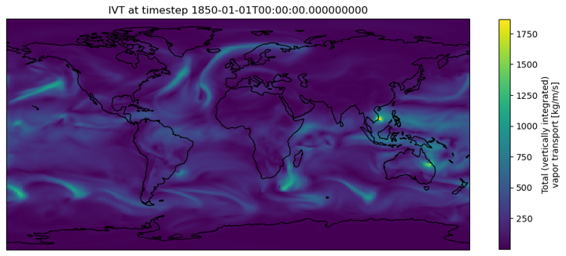
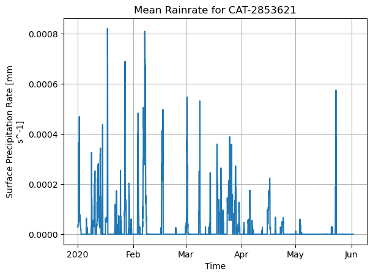
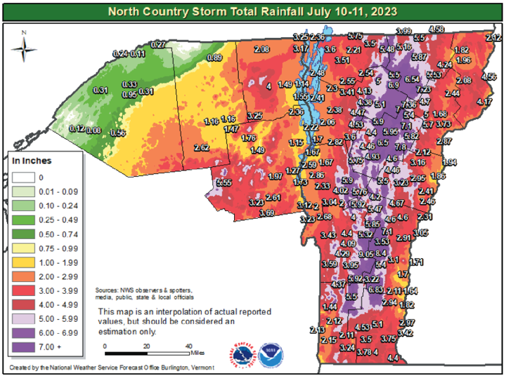

[🏠 Back to Home](/)

The "Workbench" for applied technical skills and reproducible science.

<h3 style="margin-top: 0; color: #003366;">Overview</h3>

- **Format:** Jupyter notebooks, Google Colab notebooks, and RShiny apps.
- **Goal:** Applied technical skills and reproducible science.

## Available Resources

  <a class="gallery-card" href="/access-ivt-and-explore-ar-myst">
    
    Analyzing Cloud-Native IVT Data for Atmospheric Rivers
    A Jupyter notebook showing how to work with a HydroShare-hosted Zarr dataset of integrated vapor transport (IVT) in Python, including cloud access, time and location subsetting, atmospheric river detection, event categorization, and saving outputs back to HydroShare.
  </a>
  <a class="gallery-card" href="/collecting-and-manipulating-aorc-v1-1-myst">
    
    Collecting and Manipulating AORC Meteorological Data
    A Jupyter notebook showing how to work with the NOAA Analysis of Record for Calibration (AORC) meteorological dataset from the cloud in Python, including subsetting, visualization, and linking gridded data to watershed boundaries.
  </a>
  <a class="gallery-card" href="/access-nwm-forecasts-using-bigquery-myst">
    
    Accessing National Water Model Forecasts using BigQuery
    A Jupyter notebook showing how to access operational NOAA National Water Model forecasts in Python through the CIROH BigQuery API, including retrieving streamflow time series, comparing forecasts across reference times, and mapping model reaches.
  </a>

