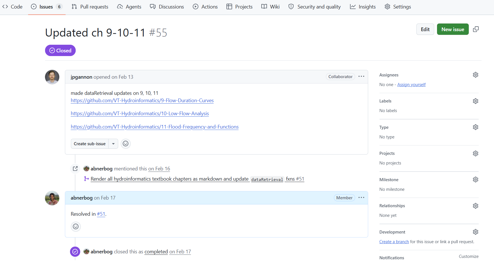

The portal displays materials maintained in their original repositories. Updating your source repository does not by itself update the version displayed in the portal. Once your changes are ready, let us know so the portal team can update its reference to the newer version.

## Update your source material

1. Make and review your changes in the repository where the material is maintained.
2. Publish the changes to the branch or release that the portal should use.
3. Check that the updated files are available at the source repository.

For example, authors of individual chapters in the Hydroinformatics book maintain their chapters in the chapter repositories, separate from the portal.

## Tell us which version to use

Open an issue in the [Water Content Portal issue tracker](https://github.com/CUAHSI/Water-Content-Portal/issues) and include:

- The portal page that should be updated.
- A link to the source repository and the specific file or folder, if applicable.
- The branch, tag, release, or commit containing the changes.
- A brief description of what changed and whether the portal page needs any additional attention.

Providing the specific version helps us identify the changes you want displayed. The portal team can then update its reference and check that the affected page still appears correctly.

## Keep citations current

If you have a corresponding HydroShare resource, update it when you release a new version of your content. Follow [Making Your Content Citable](making-content-citable.md) for the steps to keep the resource and its citation information aligned with your source material.

For an overview of how the portal connects to source repositories, see the [content management workflow](contribute.md#content-management-workflow).
