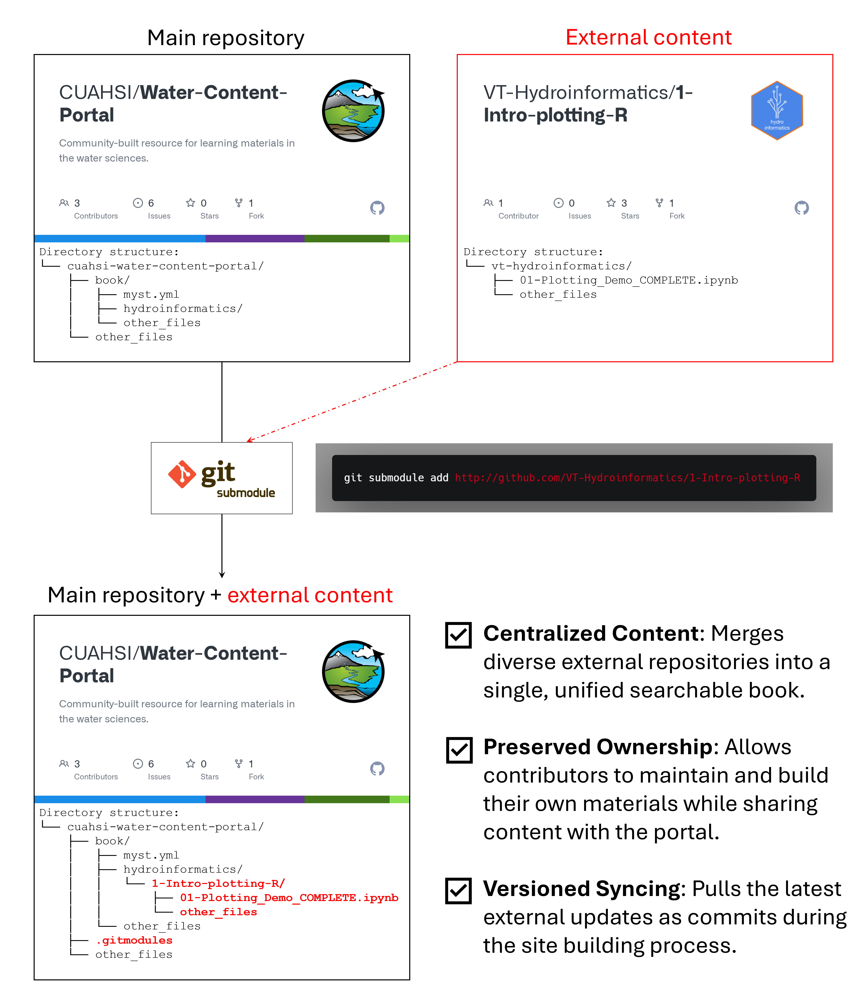

The **CUAHSI Water Content Portal** is a community-driven resource. We rely on contributions from water science researchers and educators to keep our learning materials accurate and comprehensive.

# Ways to Contribute

There are three primary ways you can help improve this resource:

1. **Suggest a platform edit:** Report a typo, broken link, navigation issue, or other problem with the portal. See [Suggesting a platform edit](contribute-platform-edits.md).
2. **Add existing content:** Ask us to include educational water science materials you already maintain. See [Requesting to add existing content](contribute-existing-content.md).
3. **Keep contributed content up to date:** Update the material in its source repository, then let us know so we can update the portal. See [Keeping your portal content up to date](contribute-content-updates.md).

# Content Management Workflow

The portal aggregates educational resources from contributors' external repositories using [**Git submodules**](https://git-scm.com/book/en/v2/Git-Tools-Submodules). The source material stays in its original repository, and the portal points to a specific version of that material. When a source repository changes, the portal needs to be updated to point to the newer version.

The diagram below shows this workflow using [Chapter 1 of the Hydroinformatics book](https://water-content-portal.cuahsi.io/plotting-demo-complete/) as an example:

If you maintain an existing resource, start with [Requesting to add existing content](contribute-existing-content.md). If your resource is already in the portal, follow [Keeping your portal content up to date](contribute-content-updates.md) when you publish changes.
