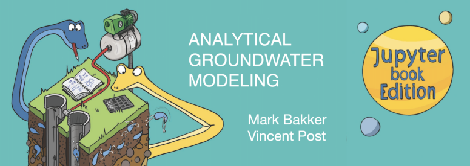

# Introduction

Analytical Groundwater Modeling is an interactive Jupyter Book on using Python to build analytic solutions for groundwater flow. It works through one-dimensional and two-dimensional flow problems in confined, semi-confined, and unconfined aquifers, under steady and transient conditions, with wells, rivers, areal recharge, and coastal aquifers where tides and the freshwater-saltwater interface come into play.

Every figure in the book is generated by Python code shown alongside it, and many of the figures are interactive (e.g., sliders to let you change a parameter and watch the solution update), and a few problems are illustrated with short videos. The code behind a figure can be copied straight into a notebook of your own on your own machine and rerun with your own numbers.

**[View the book here](https://interactive-education.gw-project.org/analytical-groundwater-modeling/chap0/0_basics_of_groundwater_flow.html)** hosted through [The Groundwater Project](https://gw-project.org/).

## Table of contents:

_Note that Chapter 0 provides a basics of groundwater flow including Darcy's law, aquifer types, and the flow equation that the rest of the book builds on._

1.  **Steady One-Dimensional Flow with Constant Transmissivity:** *Confined flow between fixed boundaries, with wells and areal recharge added in.*
2.  **Steady One-Dimensional Semi-Confined Flow:** *Leaky aquifers, using the leakage factor to describe head loss through a confining layer.*
3.  **Steady One-Dimensional Unconfined Flow with Variable Saturated Thickness:** *Unconfined flow with the Dupuit approximation, where the water table itself sets the transmissivity.*
4.  **Steady One-Dimensional Flow in Coastal Aquifers:** *Position of the freshwater-saltwater interface and outflow near a coastline.*
5.  **Transient One-Dimensional Flow:** *Time-varying heads from changing boundary conditions and recharge, with an introduction to time series analysis.*
6.  **Steady Two-Dimensional Flow to Wells:** *Radial flow to single and multiple wells, well interference, and capture zones.*
7.  **Steady Two-Dimensional Flow to Wells in Uniform Background Flow:** *Superposition of well flow and regional flow, stagnation points, and image wells.*
8.  **Analytic Element Modeling of Steady Two-Dimensional Flow:** *Building models from combinations of wells, line elements, and inhomogeneities using the analytic element method.*
9.  **Transient Two-Dimensional Flow:** *Time-dependent flow to wells, including Theis-type solutions and multi-aquifer systems.*
10. **Steady Two-Dimensional Flow in the Vertical Plane:** *Cross-sectional flow, seepage, and vertical flow components near partially penetrating features.*
