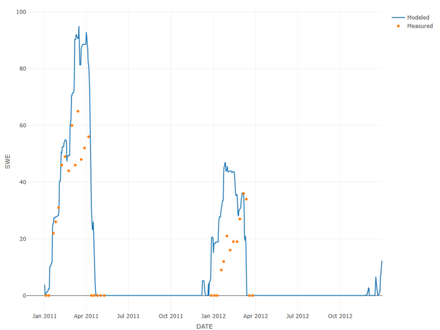
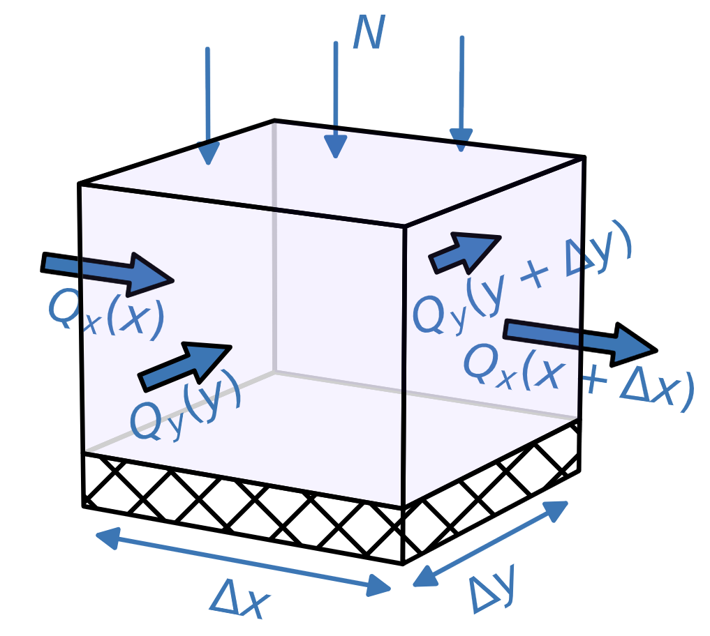

  <a class="gallery-card" href="/hydroinformatics">
    
    Hydroinformatics Textbook
    A comprehensive guide to common hydrology data analyses using R.
    hydrologystatisticsgeospatialmodeling
    rdataRetrieval
  </a>
    <a class="gallery-card" href="/analytical-groundwater-modeling">
    
    Analytical Groundwater Modeling
    A hands-on introduction to groundwater flow and analytical modeling, with interactive Python examples and exercises.
    groundwatermodeling
    pythonjupyter
  </a>

