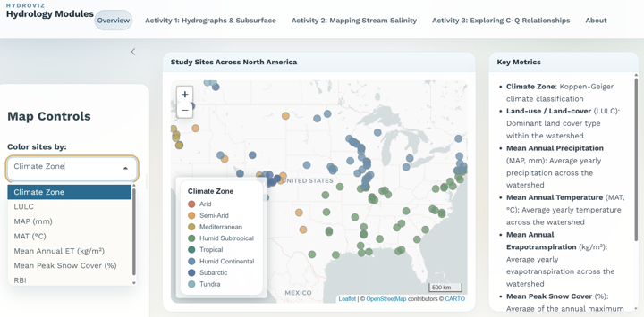

  <a class="gallery-card" href="/readme">
    
    HydroViz Teaching Modules
    A set of three guided activities built around an interactive app for exploring hydrologic and geochemical concepts through the exploration of real-world data from rivers across North America.
    hydrologygeochemistryteaching
    interactive app
  </a>

